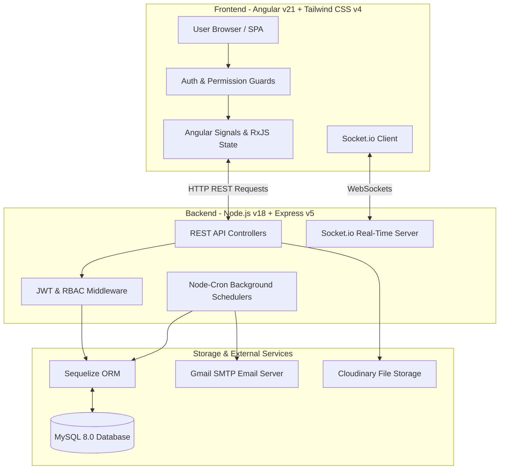

# 📚 Project Analysis, Requirements & Architecture Specification

This document contains a comprehensive, question-and-answer formatted analysis of the **Role-Based Workflow & Task Management System**. It covers the project profile, problem statement, system analysis, requirement specifications, technology stack, and architectural decisions.

---

## 1. Introduction & Project Overview

### Question 1.6: What is the Project Profile for this application?

**Answer:**
* **Project Title:** Role-Based Workflow & Task Management System
* **Organization / Target Context:** Enterprise Multi-Tenant Workspace Environments & Distributed Engineering / Operations Teams.
* **Duration:** Iterative Agile Release Cycle (Design, Prototyping, Implementation, Verification).
* **Type of Project:** Full-Stack Web Application (Decoupled Single Page Application with Server-Side Rendering support and RESTful API backend).
* **Key Stakeholders:** Organization Administrators, Team Leads / Reviewers, Assignees / Team Members, System Auditors.

---

### Question 1.7: What is the Problem Statement addressed by this project?

**Answer:**
Modern organizations face significant friction in task management and workflow execution due to several key pain points:
1. **Lack of Fine-Grained Access Control:** Legacy task systems use rigid, hardcoded roles (e.g., just "Admin" vs "User"), preventing organizations from creating custom role permissions (such as limiting who can approve tasks, delete logs, or invite users).
2. **Unregulated Task Approval Lifecycles:** Tasks are frequently marked as "Done" without formal verification, leading to quality assurance lapses. There is no dedicated Review Queue or recorded justification for task rejections.
3. **SLA Deadlines & Overdue Tasks Going Unnoticed:** Without automated monitoring, tasks past their due date stall silently without notifying team leads or assignees.
4. **Information Silos & Poor Audit Tracking:** Changes to task statuses, attachments, and comments are scattered, making it impossible to audit past activities or determine accountability.
5. **Delayed Communication:** Teams rely on manual status updates rather than receiving instant real-time notifications when assigned a task, mentioned in a comment, or asked for a review.

---

### Question 1.8: What are the Objectives & Scope of the Project?

**Answer:**

#### **Objectives:**
* Automate the multi-tenant organization onboarding process with self-seeding permission catalogs.
* Provide an administrative dashboard for dynamically defining custom roles and assigning explicit permission codes.
* Enforce a structured task state machine (`TODO` ➔ `IN_PROGRESS` ➔ `COMPLETED` ➔ `APPROVED` / `REJECTED`) with an integrated Review Queue.
* Implement real-time Socket.io notifications for instantaneous user updates across status updates and task assignments.
* Automate deadline tracking via background cron jobs to flag delayed tasks (`isDelayed`) and send due date reminders.
* Provide cloud-based file attachment management and automated Excel export features for dashboard metrics and task audit logs.

#### **Scope of the System:**
* **In-Scope:** Organization registration, user authentication (JWT), role & permission management, task CRUD operations, assignment & reviewer tracking, file uploads (Cloudinary integration), task comments, real-time socket alerts, background cron schedulers, report generation, and paginated data views.
* **Out-of-Scope (Future Enhancements):** Native mobile applications (iOS/Android), third-party payment gateway integration, and multi-language localization.

---

### Question 1.9: Which SDLC Methodology was used to develop this application?

**Answer:**
The project was developed using the **Agile / Scrum Software Development Life Cycle (SDLC)** methodology.

* **Sprint-Based Iterations:** Development was divided into 2-week sprints, focusing on incremental delivery (Sprint 1: Core REST APIs & Database Models; Sprint 2: Frontend Architecture & RBAC Guards; Sprint 3: Real-Time Sockets & Review Queue; Sprint 4: Background Cron Jobs, Pagination & Reporting).
* **Continuous Feedback & Testing:** Features were validated through Vitest unit tests and real-time browser subagent verification.
* **Modular Component Architecture:** Angular standalone components and Express modular routes were implemented independently, ensuring seamless integration and maintenance.

---

## 2. System Analysis

### Question 2.1: What are the limitations of the existing systems?

**Answer:**
Existing spreadsheet-based or monolithic task management tools exhibit the following limitations:
* **Manual Data Entry:** Updating task progress relies on human memory, causing delays in metric tracking.
* **Static Permission Models:** Standard systems lack customizable permission matrices, causing data security risks when non-admin users gain unauthorized edit access.
* **No Verification Gate:** Tasks transition directly to completed without requiring reviewer sign-off.
* **Lack of Real-time Syncing:** Users must refresh web pages manually to check if new comments or task assignments have occurred.
* **Unstructured File Storage:** Files stored locally on individual machines or email threads get lost easily.

---

### Question 2.2: What is the Proposed Solution, and how does it overcome these limitations?

**Answer:**
The **Role-Based Workflow & Task Management System** solves these limitations by introducing:
1. **Dynamic RBAC Security Engine:** Organizations define custom roles (e.g., "QC Lead", "Developer") and map exact permission codes (`CREATE_TASK`, `APPROVE_TASK`, `DELETE_USER`), enforced on both frontend Angular router guards and backend Express authorization middleware.
2. **Formal Review Queue & State Machine:** Tasks submitted by assignees move to `COMPLETED` status and enter the assigned reviewer's **Review Queue**. Reviewers can either `APPROVE` the work or `REJECT` it with mandatory feedback reasons.
3. **Automated Background Cron Service:** Node-cron schedulers run hourly checks to flag overdue tasks (`isDelayed = true`) and send automated reminders 24 hours prior to due dates.
4. **Real-time Socket.io Server:** Instant push notifications alert users of comments, approvals, or rejections without manual page reloading.
5. **Integrated Cloud File Management:** Attachments (PNG, JPG, PDF) are safely uploaded to Cloudinary cloud storage via Multer integration.

---

### Question 2.3: How was the Feasibility Study conducted (Technical, Operational, Economic)?

**Answer:**

1. **Technical Feasibility:** 
   * The selected technology stack (Angular 21, Node.js 18+, Express 5, MySQL 8, Socket.io) is mature, production-proven, and supported by extensive ecosystems.
   * Sequelize ORM handles relational integrity, migrations, and transactional safety efficiently.
2. **Operational Feasibility:**
   * The user interface features intuitive navigation with responsive Tailwind CSS v4 components.
   * Self-explanatory status badges, filters, search bars, and clear paginated views ensure zero training time for new team members.
3. **Economic Feasibility:**
   * Built entirely using open-source, open-license frameworks (MIT/ISC).
   * Cloud services like Cloudinary offer generous free dev tiers, minimizing hosting costs during deployment.

---

### Question 2.4: What are the Requirement Specifications (Functional & Non-Functional)?

#### **2.4.1 Functional Requirements (User Stories):**

* **User Story 1 (Organization Bootstrapping):**
  > *As an Organization Administrator*, I can register a new tenant organization so that an `ADMIN` role pre-loaded with all system permissions is automatically created alongside my user account.
* **User Story 2 (Role & Permission Management):**
  > *As an Administrator*, I can create new roles and assign specific permission codes (e.g., `APPROVE_TASK`, `VIEW_USERS`) so that team members only access features relevant to their position.
* **User Story 3 (Task Creation & Assignment):**
  > *As a Project Manager*, I can create tasks with priority, due date, assigned worker, and designated reviewer so that responsibilities are clearly allocated.
* **User Story 4 (Task Execution & Review Queue):**
  > *As a Team Worker*, I can change task status to `IN_PROGRESS` or `COMPLETED`, add comments, and upload attachments. *As a Reviewer*, I can view my Review Queue to approve or reject completed tasks.
* **User Story 5 (Notifications & Audit Logs):**
  > *As a User*, I can view real-time socket notifications and read page-by-page paginated task activity logs to inspect historical workflow events.

#### **2.4.2 Non-Functional Requirements:**

* **Performance:** API endpoint response times under 200ms; frontend Angular Signals provide instant UI re-rendering.
* **Security:** Passwords hashed using `bcryptjs` (cost factor 10); API endpoints protected via JSON Web Tokens (JWT); HTTP headers hardened with `helmet`.
* **Scalability:** Stateless JWT authentication allows horizontal backend scaling; Sequelize connection pooling handles concurrent database queries.
* **Maintainability:** Modular file organization following clean layered architecture (Controllers ➔ Services ➔ Models).
* **Usability:** Fully responsive layout with unified paginated controls (7 items per page for comments/activity, 10 items per page for tasks/users/roles).

---

## 3. Technology Stack & Architecture

### Question 3.1: What is the System Architecture Diagram?

**Answer:**

---

### Question 3.2: What is the detailed Technology Stack?

**Answer:**

#### **3.2.1 Frontend:**
* **Angular v21:** Modern Web Framework with Standalone Components, Signals, and Control Flow (`@if`, `@for`).
* **Tailwind CSS v4:** Utility-first CSS framework with PostCSS for high-performance responsive styling.
* **RxJS:** Reactive extensions for handling async data streams.
* **Vitest:** Blazing-fast unit testing runner.

#### **3.2.2 Backend:**
* **Node.js (ES Modules):** Asynchronous event-driven JavaScript runtime environment.
* **Express.js v5:** Web framework for constructing RESTful endpoints.
* **Sequelize ORM:** Object-Relational Mapper for MySQL table modeling, migrations, and transactions.
* **Socket.io:** WebSockets engine for instant real-time notification alerts.
* **Node-Cron:** Scheduler for automated task reminders and overdue checks.
* **Nodemailer:** Transporter for SMTP email notifications.
* **ExcelJS & PDFKit:** Report generation libraries.

#### **3.2.3 Database:**
* **MySQL 8.0 (`workflow_engine`):** Relational Database Management System storing users, roles, permissions, tasks, comments, attachments, activities, and notifications.

#### **3.2.4 Development & Operational Tools:**
* **VS Code:** Primary Integrated Development Environment (IDE).
* **Git & GitHub:** Source version control and collaboration platform.
* **Postman / REST Clients:** API testing and debugging tools.
* **Cloudinary Console:** Cloud-based media file inspection manager.

---

### Question 3.3: What is the Justification for choosing this Technology Stack?

**Answer:**

| Technology Chosen | Alternative Considered | Reason & Justification for Choice |
|---|---|---|
| **Angular v21** | React / Vue.js | Angular provides a complete out-of-the-box framework with strict TypeScript integration, built-in router guards, dependency injection, and native Signals state management without requiring third-party library stitching. |
| **Node.js + Express 5** | Python (Django) / Java (Spring) | Node's non-blocking event-driven I/O is ideal for real-time WebSocket applications (Socket.io). Using JavaScript/TypeScript end-to-end simplifies code reuse between frontend and backend models. |
| **MySQL + Sequelize** | MongoDB (Mongoose) | The system's domain model (Organizations ↔ Users ↔ Roles ↔ Permissions ↔ Tasks) is highly relational. A relational DB with strict Foreign Keys, ACID transactions, and Sequelize ORM joins prevents data inconsistencies. |
| **Tailwind CSS v4** | Bootstrap / Material UI | Tailwind v4 offers superior UI design flexibility, lower CSS bundle footprints, and utility classes that make creating modern glassmorphic dashboards fast and maintainable. |
